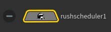
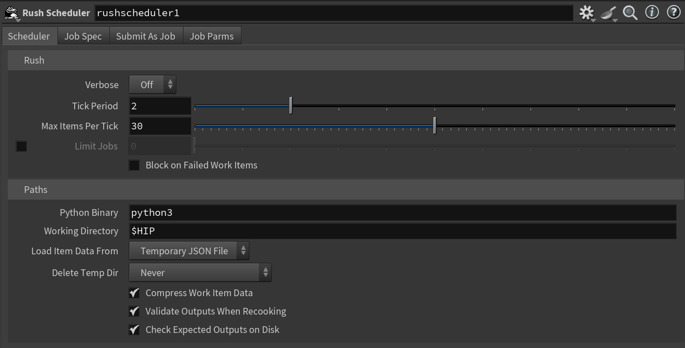

# Houdini Rush Scheduler
This is a scheduler node that uses the Rush render queue (103.07f5 and up) inside Houdini 20.x and up.

Rush Render Queue is network render queing software for computer graphics production.

See the [Rush website](https://www.seriss.com/rush/) for more information.

### Installation
A Houdini "package" definition is included for easy installation.  To install, copy all files and folders in the "packages" folder to the Houdini preferences "package" subfolder.  Location (for Houdini 20.0):

**Linux**: `~/houdini20.0/packages`
**Windows**: `%HOME%/houdini20.0/packages`
**Mac**: `~/Library/Preferences/houdini/20.0/packages`

### Screenshots

#### Node

#### Interface

#### TODO
- Show the use cases, including as a simple scheduler, and with "Submit As Job".
- Include a technical description of how it works (breadcrumbs)
